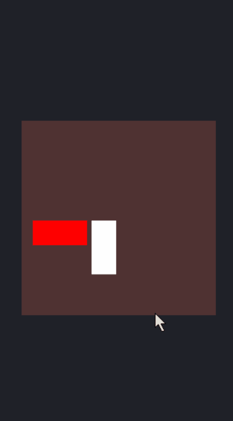
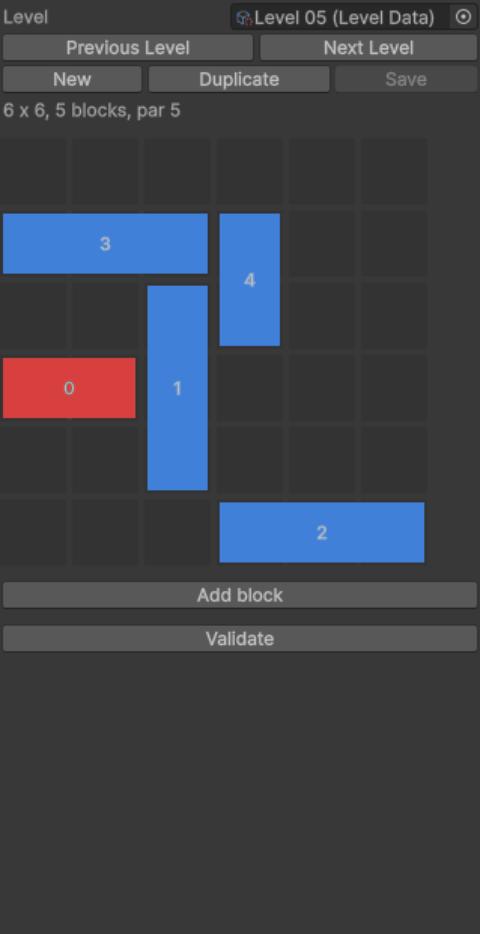
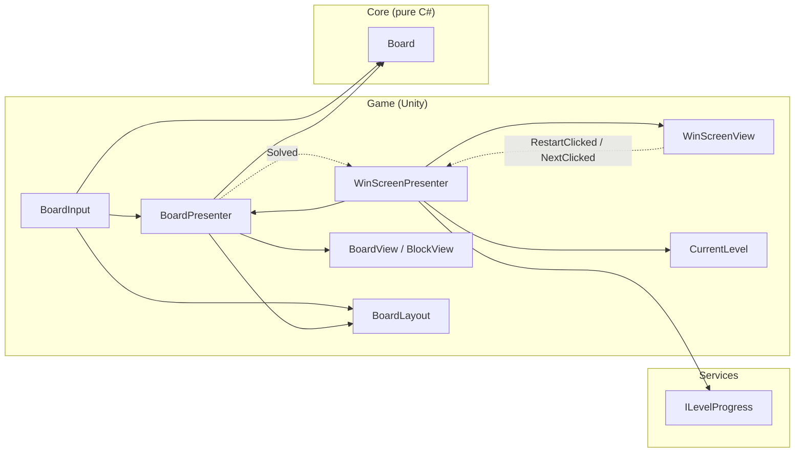

# Sliding Block Escape

A sliding-block puzzle game for Android, built in Unity 6.

Blocks on a grid slide only along their own axis. Clear a path so the red target block can exit the board on the right.



> Status: in development. Playable from Level 01 to Level 10. Next: CI, then a C# backend. See the [Roadmap](docs/ROADMAP.md).

## Features

- **Touch drag input:** blocks follow the finger, stop at walls and other blocks, and snap to the grid on release.
- **10 levels in a row:** a Next button on the win screen, hidden on the last level.
- **Saved progress:** the game continues on the level you were playing, even after the app is closed.
- **A BFS solver** that proves every level is solvable and finds its fewest-moves solution (par).
- **A custom level editor** inside Unity, with one-click validation by the solver.
- **116 unit tests** for the puzzle core, which runs without the engine.

## Level editor



A custom `EditorWindow` (**Sliding Block → Level Editor**) for building levels:

- Click to select a block, drag to move it, or edit position, length, axis and target in the panel.
- Add and delete blocks; create, duplicate and save level assets; step through levels with Previous / Next.
- Full Undo / Redo: every edit goes through `SerializedObject`.
- **Validate** runs the solver on the level and shows the result: unsolvable, or solvable in N moves with the states explored, the time, and the solution. The fewest-moves count is saved in the level as its par.

## Solver

`BoardSolver` is a breadth-first search over board states. BFS explores all positions 1 move away, then 2 moves away, and so on, so the first solved state it finds is always a shortest solution.

- **Compact states:** a block can only slide along its own axis, so a state is just one coordinate per block. `BoardStateCodec` packs those coordinates into a single `ulong` (3 bits per block on a 6×6 board), which makes states cheap to hash and compare.
- **One dictionary for two jobs:** it maps each state to the state and move it came from. That makes it the visited set and the breadcrumb trail for rebuilding the path.
- **Results for the current levels** (measured outside Unity, .NET 10):

| Level | Par | States explored | Time |
| --- | --- | --- | --- |
| 01 | 2 | 3 | < 0.1 ms |
| 03 | 3 | 12 | 0.1 ms |
| 05 | 5 | 72 | 0.8 ms |
| 06 | 6 | 4,306 | 61 ms |
| 08 | 8 | 2,432 | 31 ms |
| 10 | 10 | 3,473 | 49 ms |

## Tech stack

| Area | Choice |
| --- | --- |
| Engine | Unity 6 (6000.6), URP 2D renderer |
| Dependency injection | VContainer |
| Async | UniTask |
| Tweens | LitMotion |
| Save data | PlayerPrefs, behind an interface |
| Testing | Unity Test Framework (Edit Mode) |
| Input | Input System (touch drag) |
| CI/CD | GitHub Actions: `dotnet test` on Core, GameCI Unity tests and Android build (planned) |
| Backend | ASP.NET Core (C#), reuses `Core` to verify solutions on the server (planned) |
| Cloud | Google Cloud Run + Firestore (planned) |
| Cloud save | Offline-first, with versions and a merge rule for conflicts (planned) |
| Leaderboard | Redis sorted sets (planned) |
| Remote config and A/B tests | Our own `/config` endpoint on the backend (planned) |
| Content loading | Levels as JSON from the backend (planned); Addressables (stretch) |

## Project layout

Each folder under `Assets/_Project/` is its own assembly, so the puzzle core cannot depend on Unity.

```
Assets/_Project/
  Core/        Pure C#: board, blocks, moves, rules, state codec, BFS solver (no UnityEngine)
  Core.Tests/  Edit Mode unit tests for Core
  Data/        LevelData and LevelPack ScriptableObjects
  Editor/      Level editor window and validation
  Game/        MonoBehaviour views, input, presenters, the VContainer scope
  Levels/      Level assets and level packs
  Services/    Save data behind interfaces (backend client, cloud save and remote config planned)
  UI/          (planned) Menu screens: views + presenters (MVP)
```

## Architecture

The game uses **MVP** (Model-View-Presenter) with **dependency injection** (VContainer). The model lives in `Core`, which is pure C# with no `UnityEngine` reference, so every puzzle rule can be unit tested without the engine. Views are passive MonoBehaviours, and presenters connect them to the model.



Solid arrows are direct calls (the class holds a reference). Dotted arrows are C# events. Nothing in `Core` references `Game`.

`GameLifetimeScope` is the composition root. It loads the saved level index from `ILevelProgress`, falls back to the first level if the index no longer fits the `LevelPack`, builds the `Board` from that level, and injects everything through constructors.

**A move, step by step**

1. `BoardInput` reads the pointer each frame (`ITickable`). On press, it converts the screen point to a cell with `BoardLayout` and asks `Board` which block is there and how far it can slide.
2. While dragging, it clamps the offset and calls `BoardPresenter.PreviewDrag`, so the block follows the finger.
3. On release, it rounds to whole cells and calls `BoardPresenter.EndDrag`.
4. The presenter validates and applies the move on `Board` (`CanMove`, `ApplyMove`), then animates the `BlockView` with LitMotion. An invalid or zero-length move snaps back.
5. After the animation, if `Board.IsSolved`, the presenter raises `Solved`, and `WinScreenPresenter` shows the win screen. Next is shown unless this is the last level.
6. Next saves the next level index and reloads the scene. Restart reloads the scene on the same level.

**Testing:** `Core` is covered by 116 Edit Mode tests (NUnit) for positions, blocks, moves, board rules, state encoding and the BFS solver.

## Roadmap

The plan grows the game into a small live game. Details, design decisions and status are in [docs/ROADMAP.md](docs/ROADMAP.md).

| Phase | What | Status |
| --- | --- | --- |
| 1 | CI/CD with GitHub Actions: tests on every push, Android APK artifact | Planned |
| 2 | C# backend that replays the player's moves with the same `Core` rules, cloud save, Redis leaderboard, on Google Cloud | Planned |
| 3 | Profiling on a real Android phone, with before/after numbers | Planned |
| 4 | LiveOps: remote config, an A/B test, analytics events, a daily level | Planned |
| 5 | Stretch: 2-player race over WebSockets with Protobuf, Addressables | Stretch |

## Getting started

1. Install Unity 6000.6.2f1 with Android Build Support.
2. Install [Git LFS](https://git-lfs.com).
3. Clone the repo and run `sh tools/git/setup.sh` from its root (Git Bash). This enables LFS and registers Unity Smart Merge for scenes and prefabs.
4. Open the folder in Unity Hub and open `Assets/_Project/Scenes/Game.unity`.
