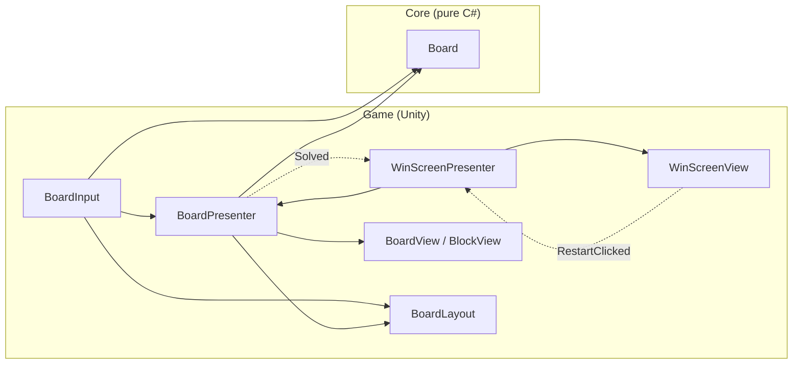

# Sliding Block Escape

A sliding-block puzzle game for Android, built in Unity 6.

Blocks on a grid slide only along their own axis. Clear a path so the target block can exit the board. Later levels add one-way tiles, linked blocks that move together, and move limits.

> Status: in development.

## Tech stack

| Area | Choice |
| --- | --- |
| Engine | Unity 6 (6000.6), URP 2D renderer |
| Dependency injection | VContainer |
| Async | UniTask |
| Tweens | LitMotion |
| Content loading | Addressables |
| Remote config | Unity Remote Config (UGS) |
| Testing | Unity Test Framework (Edit Mode) |
| Input | Input System (touch drag) |

## Project layout

Each folder under `Assets/_Project/` is its own assembly, so the puzzle core cannot depend on Unity.

```
Assets/_Project/
  Core/        Pure C#: board, blocks, moves, rules, BFS solver (no UnityEngine)
  Core.Tests/  Edit Mode unit tests for Core
  Game/        MonoBehaviour views, input, presenters, VContainer scopes
  UI/          Screens: views + presenters (MVP)
  Data/        LevelData ScriptableObjects, level packs
  Editor/      Level editor window, validation tools
  Services/    Save, remote config, analytics wrappers behind interfaces
```

## Architecture

The game uses **MVP** (Model-View-Presenter) with **dependency injection** (VContainer). The model lives in `Core`, which is pure C# with no `UnityEngine` reference, so every puzzle rule can be unit tested without the engine. Views are passive MonoBehaviours, and presenters connect them to the model.



Solid arrows are direct calls (the class holds a reference). Dotted arrows are C# events. Nothing in `Core` references `Game`. `GameLifetimeScope` is the composition root: it creates the board and the layout, registers the scene views, and injects everything through constructors.

**A move, step by step**

1. `BoardInput` reads the pointer each frame (`ITickable`). On press, it converts the screen point to a cell with `BoardLayout` and asks `Board` which block is there and how far it can slide.
2. While dragging, it clamps the offset and calls `BoardPresenter.PreviewDrag`, so the block follows the finger.
3. On release, it rounds to whole cells and calls `BoardPresenter.EndDrag`.
4. The presenter validates and applies the move on `Board` (`CanMove`, `ApplyMove`), then animates the `BlockView` with LitMotion. An invalid or zero-length move snaps back.
5. After the animation, if `Board.IsSolved`, the presenter raises `Solved`, and `WinScreenPresenter` shows the win screen. Restart reloads the scene.

**Testing:** `Core` is covered by 91 Edit Mode tests (NUnit) for positions, blocks, moves and board rules.

## Getting started

1. Install Unity 6000.6.2f1 with Android Build Support.
2. Install [Git LFS](https://git-lfs.com).
3. Clone the repo and run `sh tools/git/setup.sh` from its root (Git Bash). This enables LFS and registers Unity Smart Merge for scenes and prefabs.
4. Open the folder in Unity Hub.
